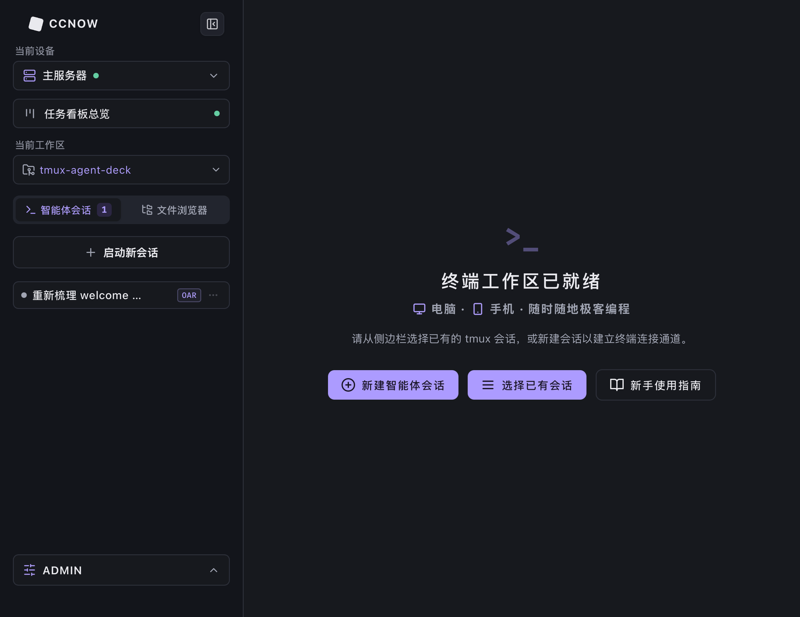
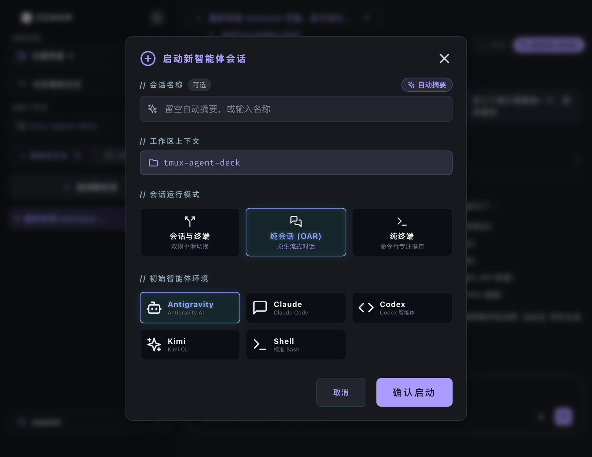
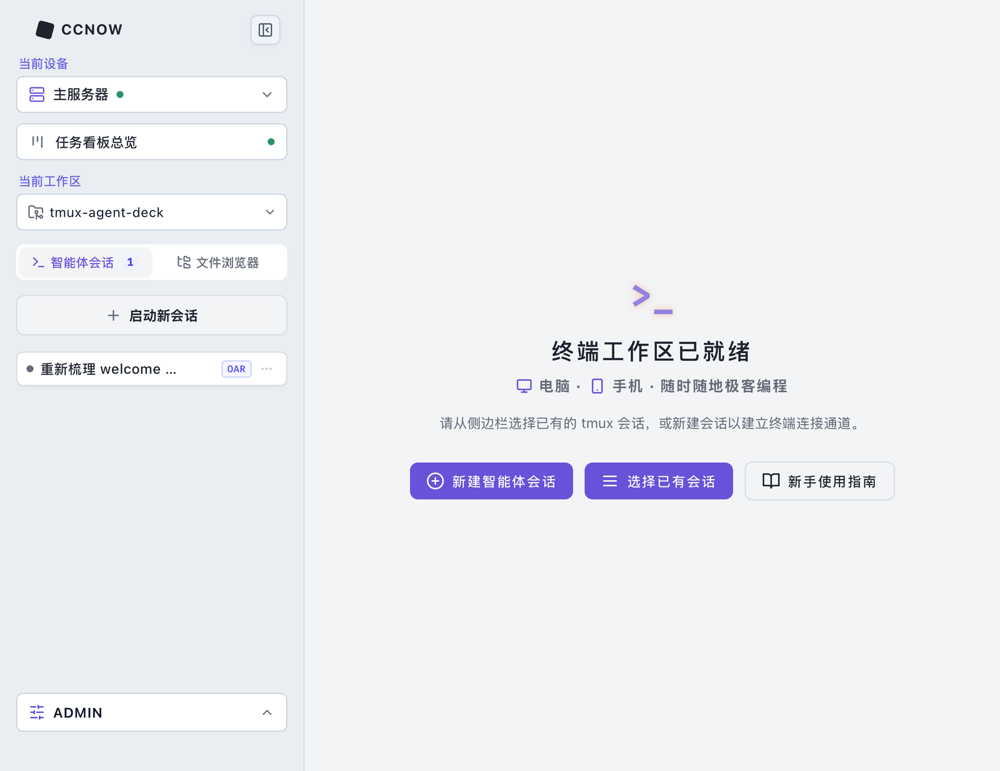
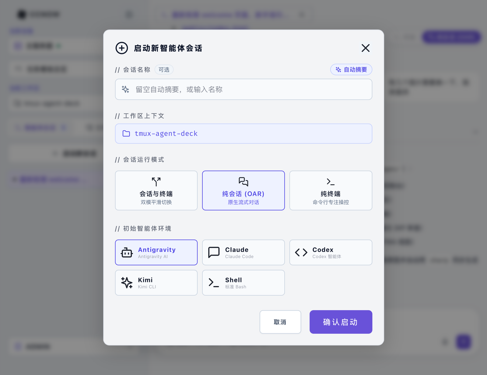

# CCNOW (`tmux-agent-deck`)

**面向 AI 编程智能体的多设备控制平面与云端工作台。**

CCNOW 以 **Control Plane + 统一算力接入** 为核心架构，通过一套 Web 工作台统一调度 **云端硬化 Docker 沙箱（云电脑）**、**特权主服务器（Host Admin）** 以及 **个人 Mac / Windows / Linux 电脑（External Edge）** 上的 AI 编程智能体（**Antigravity (`agy`)**、**Claude Code**、**Codex CLI**、**Kimi Code** 与 **Bash Shell**）。

它不仅是浏览器终端，更是一个融合了 **三模会话（双模 / OAR 免 Tmux 纯会话 / 纯终端）**、**Session-as-Task 全局任务看板**、**Mermaid 渲染与文件路径直达**、**Monaco 编辑与 Git Diff**、**作用域虚拟 Key LLM 网关** 以及 **手机/折叠屏 PWA 沉浸体验** 的 AI 原生研发控制中心。

---

## 📸 界面预览 / Screenshots

<table>
  <tr>
    <td align="center" width="50%"><b>1. 深色主题 · 多设备控制台 / Dark Console</b></td>
    <td align="center" width="50%"><b>2. 深色主题 · 启动智能体会话 / Dark Session Modal</b></td>
  </tr>
  <tr>
    <td></td>
    <td></td>
  </tr>
  <tr>
    <td align="center" width="50%"><b>3. 浅色极简 · 多设备控制台 / Light Console</b></td>
    <td align="center" width="50%"><b>4. 浅色极简 · 启动智能体会话 / Light Session Modal</b></td>
  </tr>
  <tr>
    <td></td>
    <td></td>
  </tr>
</table>

---

## 🏗️ 整体架构概览

CCNOW 采用严格的四层归属链模型，所有算力节点统一运行模块化 `ccnow-agent` 并通过 `/device-tunnel`（加密 WebSocket 隧道）反向接入控制面：

```text
Control Plane (server.js · Web UI · JWT Auth · /device-tunnel · LLM Gateway · node:sqlite)
  └── User (租户层：单人模式 / 多用户邀请码模式)
        └── Device (算力层：docker-sandbox 云电脑 | host-admin 主服务器 | external 个人电脑)
              └── Workspace (代码工作区目录)
                    └── Session (双模 Hybrid | OAR 纯会话 | 纯终端)
```

| 算力类型 (`deviceKind`) | 定位与隔离方式 | 模型 Provider 策略 | 生命周期与特点 |
| :--- | :--- | :--- | :--- |
| **`docker-sandbox`**（云电脑） | 每位用户独立硬化 Docker 容器（非 root、`--cap-drop=ALL`、CPU/内存/PIDs 硬限制） | **控制面 LLM Gateway** + 作用域虚拟 Key（`sk-ccnow-<deviceId>.<deviceSecret>`），容器内零明文上游 Key | 按需秒级唤醒，闲置自动休眠（Idle Reaper 默认 30 分钟），工作区挂载卷持久保留 |
| **`host-admin`**（主服务器） | 管理员专属云主机，通过独立 `systemd` 服务 `ccnow-host-agent.service` 常驻 | 本机回环 `http://127.0.0.1/v1` 或宿主机本地配置 | 独立于 `server.js` 进程树，重启 Web 服务不断连、不丢会话 |
| **`external`**（我的电脑） | 个人 Mac / Windows / Linux 笔记本或外部主机，一行配对命令反连 443 端口 | **设备本地配置 (BYOK)**，直连用户本机模型与 OAuth 登录态 | 零端口暴露，穿透 NAT/防火墙，支持自动补全可选依赖及**免 Tmux 运行 OAR 纯会话** |

> 详细架构与协议规范请参阅：[docs/architecture.md](docs/architecture.md) · [docs/multi_device_agent_spec.md](docs/multi_device_agent_spec.md) · [docs/oar_integration_requirements.md](docs/oar_integration_requirements.md)

---

## 🌟 核心特性

### 1. 统一多设备算力与模块化边缘 Agent (`ccnow-agent`)
- **全局设备切换器**：在侧边栏左上角一键切换云电脑、主服务器或个人电脑，整个工作台上下文（工作区、会话列表、文件树、任务看板）即时联动。
- **零门槛边缘接入**：在「设备管理」复制一次性配对命令即可接入外部设备；`ccnow-agent`（打包为单文件 CJS 分发，支持远程热更新与 `systemd`/`launchd` 守护）内置可选依赖自动安装器（`node-pty`、`ws`、`@botiverse/oar`）。
- **无 Tmux 也能用**：在未安装 Tmux 的机器（如 Windows 或极简环境）上可直接创建并运行 OAR 纯会话。

### 2. 三种会话模式 & 五大智能体环境
- **🔀 会话与终端（Hybrid 双模，推荐）**：可视化对话 UI 与完整 ANSI Tmux 终端无缝互切，兼顾阅读体验与底层掌控。
- **💬 纯会话（OAR Chat Only）**：基于 `@botiverse/oar` 标准 `defineRuntime` / `RuntimeRegistry` 扩展，原生结构化流式输出与工作区真实工具调用（ReAct 闭环），无终端按键干扰。
- **⌨️ 纯终端（Terminal Only）**：`xterm.js` + `node-pty` + Tmux 超低延迟终端，支持窗口自适应缩放与全局鼠标滚轮。
- **五大内置环境**：**Antigravity (`agy`)**、**Claude Code (`claude`)**、**Codex CLI (`codex`)**、**Kimi Code (`kimi`)** 与标准 **Bash Shell**。
- **零摩擦创建与自动摘要标题**：新建会话时名称**可留空**，系统自动分配 SQLite `AUTOINCREMENT` 严格单调自增 ID（如 `agy-12`、`oar-claude-13`），并在首条消息发出后异步调用 LLM 自动摘要清晰的任务标题。

### 3. Session-as-Task 全局任务看板总览
- 跨工作区汇聚当前设备上的全部活跃会话与待办任务，支持 **四列看板视图（需确认 / 执行中 / 待命·待验收 / 待办任务）** 与 **工作区网格视图** 自由切换。
- 支持搜索筛选、按工作区过滤、卡片行内**快捷回复指令**、行内重命名标题，以及待办任务一键拉起新会话。

### 4. 富媒体对话、代码审查与限时分享
- **Mermaid 图表渲染**：对话中的 Mermaid 架构图/流程图/时序图按需懒加载渲染为 SVG，自动适配深浅双主题，支持源码切换、复制与交互式缩放灯箱。
- **文件路径一键跳转预览**：自动识别 AI 回复与工具调用中的工作区文件路径（含 `:line` / `#L10-L20` 行号），点击直接在 Monaco 编辑器打开并定位。
- **智能体感知 `/` 快捷指令**：在对话与终端快捷栏自动匹配当前智能体专属斜杠命令（如 `agy` 的 `/plan`、`/goal`、`/swarm`，`claude` 的 `/clear`、`/compact`、`/review`，`codex` 的 `/new`、`/approvals`，`kimi` 的 `/yolo` 等）。
- **可视化文件工作台**：拖拽上传、Monaco 在线编辑、Git Diff 红绿差异筛查、HTML/Markdown/图片内嵌预览，并可为 HTML 产物生成 **1–72 小时限时免密分享链接**。

### 5. LLM 统一网关、安全隔离与可靠运维
- **LLM Gateway**：后台内置多厂商代理路由（`/v1`、`/llm/v1`）与网页端 JSON 可视化配置器（`data/llm_gateway.json`），支持按会话选择模型及 **Claude OAuth 官方直连模式**。
- **SQLite WAL 持久化**：控制面用户、邀请码、设备、工作区、会话元数据等数据统一持久化至 Node.js 原生 **`node:sqlite`**（`data/ccnow.db`，WAL 模式），附带幂等迁移脚本。
- **Systemd 进程树隔离**：`start.sh` / `stop.sh` / `restart.sh` 自动通过 `systemd-run` 将 `server.js` 隔离运行于独立单元 `ccnow-server.service`，确保脚本或 Agent 触发重启时不误杀主进程。
- **深浅双主题 & 全端 PWA**：遵循四层表面物理架构（赛博深色 / 浅色极简），支持自定义 PWA 桌面图标、手机扫码免密登录、iPhone Fold / 折叠屏视口与安全区适配、触控虚拟辅助键盘、语音输入与 Web Push（`deck-notify`）离线推送。

---

## 🛠️ 快速部署与启动

### 1. 一键安装控制面（Linux 推荐）

```bash
curl -fsSL https://raw.githubusercontent.com/RayzPub/tmux-agent-deck/main/install.sh | bash
cd tmux-agent-deck
```

### 2. 配置 `.env` 环境变量

项目根目录下的 `.env` 控制端口、鉴权、多用户模式与沙箱配额（首次运行 `start.sh` 若缺失会自动生成强密码与 `JWT_SECRET`）：

```env
# 基础网络与认证（PASSWORD >= 16 位，JWT_SECRET >= 32 位）
PORT=80
HTTPS_PORT=443
DOMAIN_NAME=your.domain.com
PASSWORD=your_secure_password_at_least_16_chars
JWT_SECRET=your_jwt_secret_key_at_least_32_chars
DEFAULT_SHELL=/bin/bash

# 可选：HTTPS SSL 证书（留空则自动降级为 HTTP）
SSL_CERT_PATH=/path/to/fullchain.pem
SSL_KEY_PATH=/path/to/privkey.key

# 多用户隔离与注册邀请码模式
MULTI_USER_ENABLED=true

# 云端托管 Docker 沙箱配置（可选）
DOCKER_SANDBOX_ENABLED=true
DOCKER_SANDBOX_IMAGE=ccnow-sandbox:latest
DOCKER_SANDBOX_MEMORY=1g
DOCKER_SANDBOX_CPUS=1
DOCKER_SANDBOX_PIDS_LIMIT=256
DOCKER_SANDBOX_IDLE_MINUTES=30

# 可选：旧版 IM 机器人通道开关（默认关闭）
IM_BOT_ENABLED=false
```

> [!IMPORTANT]
> 公网部署前请务必配置强随机 `PASSWORD`（≥16 字符）与 `JWT_SECRET`（≥32 字符），并启用 HTTPS 证书。多用户模式下，首次启动会自动根据 `PASSWORD` 初始化管理员账号 `admin`，其余用户需由管理员在网页端「系统管理 → 邀请码管理」生成一次性邀请码注册。

### 3. 启动、停止与重启服务

```bash
# 生产启动（自动执行静态资源与 ccnow-agent 增量构建，并以独立 systemd 单元后台运行）
sudo ./start.sh

# 平滑重启控制面（宿主机 ccnow-host-agent 与容器会话均不受影响）
sudo ./restart.sh

# 停止控制面服务
sudo ./stop.sh
```

非特权本地开发 / 测试启动：
```bash
PORT=3888 HTTPS_PORT=3889 SSL_CERT_PATH="" SSL_KEY_PATH="" node server.js
```

修改前端静态资源（`public/`）或 `client/src/` 后手动构建：
```bash
npm run build
```

### 4. 配置算力节点（按需启用）

#### A. 注册宿主机常驻 Agent（`host-admin`，管理员推荐）
将当前控制面所在云主机注册为独立 `systemd` 服务 `ccnow-host-agent.service`，实现重启 `server.js` 会话不断连：
```bash
sudo node scripts/setup-host-admin-agent.js
```

#### B. 构建云电脑 Docker 沙箱镜像（`docker-sandbox`，多用户推荐）
构建基于 `node:22-bookworm-slim` 的硬化非 root 沙箱镜像后，普通用户即可在网页「设备管理」一键唤醒专属云电脑：
```bash
docker build -f docker/Dockerfile.sandbox -t ccnow-sandbox:latest .
```

#### C. 接入个人电脑（`external`：Mac / Windows / Linux）
1. 登录 CCNOW Web 控制台，点击左下角 **「系统设置」➔「设备管理」**（或左上角设备下拉框中的 **「管理 / 添加设备…」**）。
2. 复制生成的一次性配对命令（10 分钟内有效，形如 `curl -fsSL https://<domain>/agent.js | node - connect --server https://<domain> --token pt_...`）。
3. 在本机终端执行，即可建立加密反向隧道；无需公网 IP，也支持通过 `ccnow-agent service install` 注册为本机开机自启守护进程。

---

## 🗄️ 数据存储与迁移（JSON ➔ `node:sqlite`）

控制面持久化数据统一保存在 `data/ccnow.db`（采用 Node.js 内置 `node:sqlite` + WAL 模式，无需额外编译原生 SQLite 驱动）。

若从早期 JSON 版本升级，控制面首次启动会自动迁移，也可随时手动执行幂等迁移脚本校验：
```bash
npm run migrate:sqlite
```

---

## 🤖 LLM 网关与智能体认证

- **配置入口**：管理员可在网页端 **「系统管理 → LLM 网关配置」** 直接在线编辑、格式化并热加载 `data/llm_gateway.json`（参考模板见 [config/llm_gateway.example.json](config/llm_gateway.example.json)）。
- **密钥零暴露**：云端沙箱容器永不写入真实上游 API Key，而是通过作用域虚拟 Key（`sk-ccnow-<deviceId>.<deviceSecret>`）访问控制面内网网关，由 `llmGatewayService` 鉴权后在内存替换为真实上游密钥转发。
- **官方 OAuth 直连**：支持在「系统管理 → 智能体配置」一键开启 **Claude OAuth 官方登录直连模式**，使用 `claude login` 订阅账号直连官方；Antigravity (`agy`) 纯会话优先使用官方原生套餐配额。
- **详细规范**：参见 [docs/agent_cli_config_guide.md](docs/agent_cli_config_guide.md)。

---

## 💬 即时通讯机器人集成（可选 / 实验性开关）

> [!NOTE]
> 旧版 Telegram / 微信（ClawBot）IM 机器人目前处于多设备架构适配期，默认**关闭**。如需在单机或过渡期启用，请在 `.env` 中显式设置 `IM_BOT_ENABLED=true` 并重启服务。

- **微信 AI 智能助理 (WeChat ClawBot)**：基于微信 iLink 网关，网页端扫码绑定个人微信，支持中文指令（`帮助`、`会话`、`切换 <会话名>`、`状态`、直接发送文本）与主动推送提醒。
- **Telegram Bot**：在 `.env` 配置 `TELEGRAM_BOT_TOKEN`（Webhook 模式需配置 HTTPS 与 `DOMAIN_NAME`），支持 `/list`、`/switch`、`/status`、`/link`、终端监视与交互式按钮审批（✅ 允许 / ❌ 拒绝）。

---

## 📂 项目目录结构

```text
tmux-agent-deck/
├── server.js                        # 控制面主入口（Express + Socket.io + 隧道与网关挂载）
├── config/                          # 环境变量加载与 LLM Gateway 配置模板
├── middlewares/                     # JWT 鉴权、设备访问守卫与通用反向代理中间件
├── routes/                          # REST API (api.js) 与 LLM 网关代理路由 (llmGateway.js)
├── services/                        # 核心业务服务层
│   ├── sqliteService.js             # node:sqlite WAL 引擎与 Schema 升级
│   ├── dbService.js                 # 用户、邀请码、系统配置持久化
│   ├── deviceService.js             # 设备注册表、一次性配对 Token 与状态管理
│   ├── containerService.js          # Docker 沙箱生命周期调度与 Idle Reaper
│   ├── llmGatewayService.js         # 多厂商模型路由与作用域虚拟 Key 鉴权
│   ├── sessionMetaService.js        # 单调自增会话 ID 分配与 AI 自动标题摘要
│   ├── agentChatService.js          # 会话消息解析、对话模式交互服务
│   ├── projectService.js            # 任务看板汇总与项目工作区服务
│   ├── fileService.js               # safeResolve 路径安全校验与 Agent CLI 环境守卫
│   ├── pushService.js               # Web Push (VAPID) 主动推送服务
│   └── ...                          # gitService / tmuxService / iconService / monitorService
├── sockets/                         # Socket.io 终端流 (terminal.js) 与 /device-tunnel 网关 (deviceGateway.js)
├── client/                          # 边缘/沙箱/宿主机统一守护进程 (ccnow-agent)
│   ├── src/                         # 模块化源码（隧道、Tmux/OAR、VFS、Git、依赖自安装、热更新、系统服务）
│   ├── oar-runtime.js               # @botiverse/oar 标准 Runtime 适配器注册
│   └── ccnow-agent.js               # esbuild 打包的单文件零依赖分发脚本
├── docker/
│   └── Dockerfile.sandbox           # 硬化非 root 云电脑沙箱镜像
├── scripts/
│   ├── setup-host-admin-agent.js    # 注册宿主机 ccnow-host-agent.service 脚本
│   └── migrate-json-to-sqlite.js    # 历史 JSON -> SQLite 幂等迁移脚本
├── bin/
│   ├── build.js                     # esbuild 生产构建（前端 Hash 资源 + ccnow-agent 打包）
│   └── deck-notify                  # 供 AI 智能体调用的主动推送 CLI Hook
├── public/                          # 前端静态资源与 ES Modules
│   ├── index.html / welcome.html / login.html / register.html / fold.html
│   ├── css/                         # 深浅双主题样式表（style.css / chat-mode.css / task-board.css 等）
│   ├── js/app.js & js/modules/      # 前端模块化控制器（deviceManager / projectOverview / chatMode / mermaidRenderer / chatFileLink / slashCommands / helpDoc 等）
│   └── sw.js                        # PWA 离线推送 Service Worker
├── docs/                            # 架构、UI、OAR、新手指南与预览截图
├── test/                            # 网关、存储、设备与会话元数据测试套件
├── start.sh / stop.sh / restart.sh  # 基于 systemd 隔离的启停脚本
└── im-bot.js                        # 可选 IM 机器人模块（IM_BOT_ENABLED=true 启用）
```

---

## 📚 相关文档索引

- 🚀 **应用内新手指南**：[docs/guide.md](docs/guide.md)
- 🏗️ **四层架构与统一算力规范**：[docs/architecture.md](docs/architecture.md)
- 🔌 **多设备互联与远程控制协议**：[docs/multi_device_agent_spec.md](docs/multi_device_agent_spec.md)
- 🧠 **OAR 智能体运行时与三模会话规范**：[docs/oar_integration_requirements.md](docs/oar_integration_requirements.md)
- ⚙️ **Claude Code & Codex CLI 配置与网关守卫指南**：[docs/agent_cli_config_guide.md](docs/agent_cli_config_guide.md)
- 📋 **项目目标拆解与任务规范**：[docs/deck_task_spec.md](docs/deck_task_spec.md)
- 🎨 **前端 UI 设计与深浅双主题规范**：[docs/ui_design_spec.md](docs/ui_design_spec.md)
- 📱 **PWA 与移动端/折叠屏适配指南**：[docs/pwa_mobile_theme_guide.md](docs/pwa_mobile_theme_guide.md)
