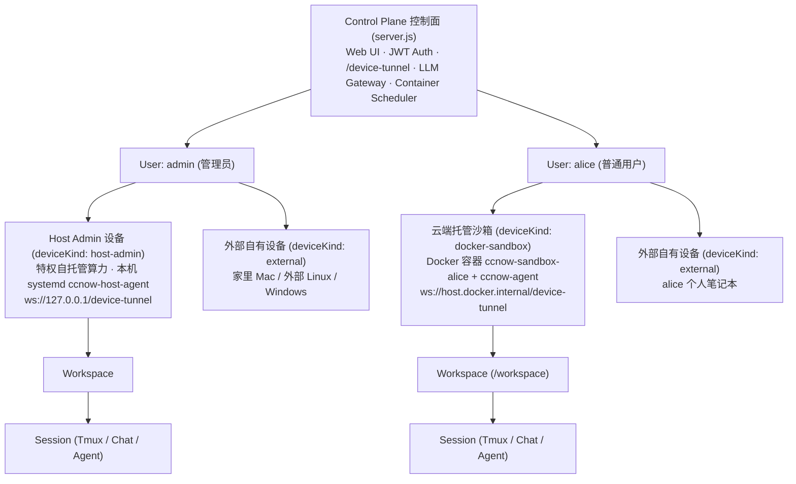

# 系统整体架构规范 (Control Plane + 统一算力设备模型)

本文档定义了 **tmux-agent-deck (CCNOW)** 的四层核心架构、单人/多用户租户模型、两类算力设备模型（Managed Docker Sandbox vs Self-Hosted External / Host Admin）以及 LLM Gateway 虚拟 Key 代理策略。

---

## 1. 四层核心架构层级

系统的核心归属链为严格树状结构：

```text
Control Plane (server.js)
  └── User (租户层：单人模式 / 多用户模式)
        └── Device (算力层：Managed Docker Sandbox / Self-Hosted External / Host Admin)
              └── Workspace (工作区目录)
                    └── Session (Tmux / Chat / AI Agent 会话)
```



---

## 2. 租户层：单人模式 vs 多用户模式

| 维度 | 单人模式 (`MULTI_USER_ENABLED=false`) | 多用户模式 (`MULTI_USER_ENABLED=true`) |
| :--- | :--- | :--- |
| **用户范围** | 仅单一隐式 `admin`（主密码登录） | `admin` + 受邀注册的多个普通用户 |
| **核心诉求** | 个人私有中控台，管云主机与个人电脑 | 多租户强隔离，防止文件越权、凭证泄露与 OOM 互相拖垮 |
| **典型算力组合** | `host-admin` + 个人 `external` 设备 | `admin` 用 `host-admin`；普通用户用 `docker-sandbox` + 个人 `external` 设备 |

---

## 3. 算力层：两类算力与三种 `deviceKind`

控制面通过统一协议 `/device-tunnel`（`sockets/deviceGateway.js` + `services/deviceService.js` + `client/ccnow-agent.js`）调度全部算力节点，本质上分为**两大类算力**：

### 3.1 托管算力（Managed Compute：`docker-sandbox`）
- **调度者**：控制面内置的 `services/containerService.js` 全权负责生命周期。
- **底层镜像**：`docker/Dockerfile.sandbox`（`ccnow-sandbox:latest`，基于 `node:26.4-trixie-slim`，非 root `uid=1000`，预装 `tmux`、`node-pty`、`@botiverse/oar`、`claude`、`codex`、`agy`、`kimi`、`pnpm`、`python3`、`ripgrep`、`fd` 等完整算力工具链）。
- **内核级隔离与硬化**：
  - 独立 rootfs、PID、Mount、Network 命名空间；
  - `--cap-drop=ALL`、`--security-opt=no-new-privileges:true`；
  - 硬性资源配额：`--memory`（默认 `1g`）、`--cpus`（默认 `1`）、`--pids-limit`（默认 `256`）；
  - 挂载卷：`workspaces/<user>` ➔ `/workspace`，`data/sandboxes/<user>/home` ➔ `/home/node`，`client/ccnow-agent.js` ➔ `/opt/ccnow/ccnow-agent.js:ro`。
- **按需唤醒与空闲休眠（Idle Reaper）**：
  - 用户点击“启动/唤醒沙箱”或调用 `POST /api/sandbox/start` 秒级拉起容器；
  - 后台 Idle Reaper 每 2 分钟巡检一次，超过 `DOCKER_SANDBOX_IDLE_MINUTES`（默认 30 分钟）且无活跃终端流时自动 `docker stop` 释放宿主机内存，所有工作区文件在挂载卷中持久保留。

### 3.2 接入算力（Self-Hosted / External Compute：`external` & `host-admin`）
控制面**只管连接与调度，不管机器本身启停**：
- **`external`（外部自有设备）**：用户自己的 Mac / Windows / Linux / 其他云主机，运行 `ccnow-agent.js` 反向连入控制面。
- **`host-admin`（特权宿主机接入算力）**：本质上是**一台特殊的 `external` 算力**——将控制面所在云主机自身通过独立系统服务 `ccnow-host-agent.service`（`scripts/setup-host-admin-agent.js`）注册为 `admin` 名下的常驻设备：
  - 连接本机回环 `ws://127.0.0.1:80/device-tunnel`；
  - 独立于 `server.js` 进程树，重启 `server.js` 时宿主机 Agent 与底层会话不断掉，几秒内自动重连；
  - 仅归属 `admin`，受防误删保护（`DELETE /api/devices/:id` 默认拒绝，除非显式传 `?force=true`）。

---

## 4. 控制面与 LLM API 代理（LLM Gateway）的平衡策略

核心原则：**谁提供算力，默认就由谁提供模型 Provider**；且**真实上游 API Key 永远只保存在控制面的 `data/llm_gateway.json`，绝不以明文形式下发给 Docker 沙箱或客户端。**

| 算力类型 | 默认模型 Provider 来源 | 认证与流量路径 | 设计考量 |
| :--- | :--- | :--- | :--- |
| **`host-admin`（宿主机）** | 控制面 LLM Proxy（或宿主机本地配置） | `http://127.0.0.1/v1`（Loopback 回环） | 零延迟、零公网带宽消耗 |
| **`docker-sandbox`（云端沙箱）** | **控制面 LLM Proxy**（自动对齐 Claude / Codex 配置） | 内网 `http://host.docker.internal/v1` + **作用域虚拟 Key**：`sk-ccnow-<deviceId>.<deviceSecret>` | 走 Docker 桥接内网不花公网带宽；`llmGatewayService` 校验虚拟 Key 后在内存替换为真实上游 Key，容器内无法窃取真实 Key |
| **`external`（自带算力）** | **设备本地集群 / 本地配置（Local Provider / BYOK）** | 设备直连用户自有模型端点（不经过云主机） | 控制面保持纯粹，不覆盖用户本机 CLI 配置，不消耗云主机公网带宽与 Token 额度 |

### 4.1 各类 Agent CLI 在沙箱与自带算力下的差异
- **Claude Code**：`external` 保留用户本机 `~/.claude/settings.json` 与登录态；`docker-sandbox` 启动时自动清理容器内 `~/.claude/settings.json` 的冲突 `env` 字段，使注入的 `ANTHROPIC_BASE_URL` 与虚拟 `ANTHROPIC_API_KEY` 生效。
- **Codex CLI**：`external` 保留用户本机 `~/.codex/config.toml`；`docker-sandbox` 启动时由 `containerService.js` 自动写入 `~/.codex/config.toml`（`deck_gateway` 指向 `http://host.docker.internal/v1`，`env_key = "OPENAI_API_KEY"`），无明文 Key。
- **Antigravity (`agy`)**：`external` 使用本机 Google OAuth / Vertex AI；`docker-sandbox` 内若运行 `agy`，由用户在容器挂载卷 `data/sandboxes/<user>/home/.gemini/` 中独立认证，与标准 LLM Proxy 互不冲突。

---

## 5. 相关关键文件索引

- **控制面与配置**：`server.js`、`config/index.js`、`routes/api.js`、`routes/llmGateway.js`
- **设备隧道与调度**：`sockets/deviceGateway.js`、`services/deviceService.js`、`services/containerService.js`
- **LLM 网关代理**：`services/llmGatewayService.js`
- **边缘/容器客户端**：`client/ccnow-agent.js`
- **宿主机与镜像脚本**：`scripts/setup-host-admin-agent.js`、`docker/Dockerfile.sandbox`
- **前端设备与沙箱面板**：`public/js/modules/deviceManager.js`、`public/index.html`、`public/css/invite-modal.css`
