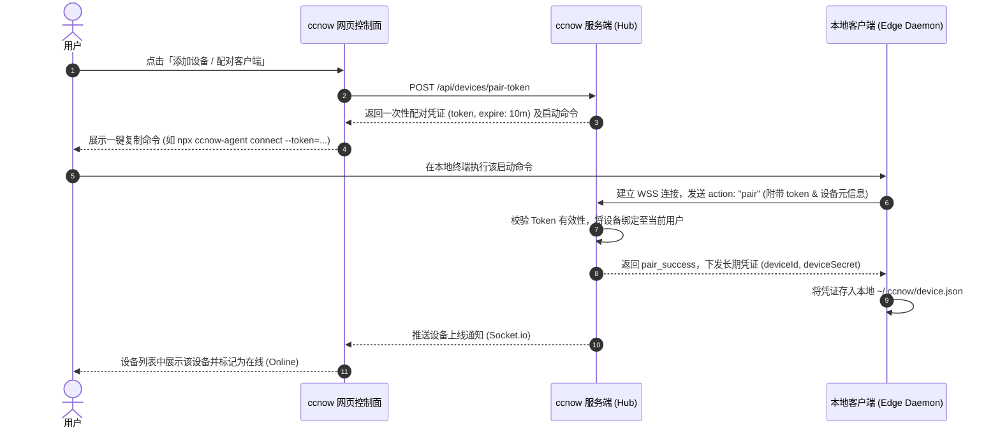

# 多设备互联与本地 Agent 远程控制技术方案规范 (Multi-Device Agent Remote Control Specification)

## 1. 概述与需求背景

随着 AI Agent（如 Claude Code、Codex CLI 等智能体）深入日常开发流程，开发者通常在本地电脑（工作机、笔记本等）上拥有本地代码库、专属开发环境及已配置的 Agent 工具链。现有的 **ccnow (tmux-agent-deck)** 作为云端集中化服务，具备强大的多会话管理与 Web 端交互能力。

本方案旨在实现**“多设备互联”**：
- **控制面 (Control Plane)**：以 ccnow 网站为中心控制面，负责用户鉴权、设备绑定、在线状态维护和远程控制会话调度。
- **受控端 (Edge Client)**：提供可一键安装到用户个人电脑上的轻量客户端（`ccnow-agent`），主动向控制面建立 WebSocket 长连接。
- **控制目标**：控制本地设备上的 **Agent 智能体**（而非全量桌面或文件系统的重度控制），实现网页下发指令、本地执行、实时流式响应的闭环。

---

## 2. 核心架构与角色

```mermaid
flowchart TD
    subgraph Browser ["Web 控制面 (用户浏览器)"]
        UI["ccnow Web 界面\n- 设备状态列表\n- Agent 对话/任务分发"]
    end

    subgraph Hub ["ccnow 云端控制面 (Server)"]
        DevSvc["设备与配对服务\n(DeviceService)"]
        TunnelGateway["WebSocket 隧道网关\n(/device-tunnel)"]
        AgentRouter["Agent 路由与分发\n(AgentChatService)"]
    end

    subgraph LocalPC ["用户本地电脑 (Edge)"]
        Client["ccnow-agent 轻量客户端\n- 连接维持/心跳保活\n- 本地 Agent 驱动器"]
        LocalAgent["本地 Agent 智能体\n(Claude Code / 本地 CLI)"]
    end

    UI <-->|Socket.io / HTTP| Hub
    TunnelGateway <-->|WebSocket 长连接 (主动反向出站)| Client
    Client <-->|Stdio / IPC| LocalAgent
```

### 角色职责分工

| 角色 | 部署位置 | 核心职责 |
| :--- | :--- | :--- |
| **注册用户** | 浏览器端 | 登录控制面，生成配对指令，查看在线设备，发起对指定设备 Agent 的远程会话 |
| **ccnow 控制面** | 云端服务器 | 负责设备注册表管理、一次性配对 Token 签发与校验、WebSocket 连接池维护、指令与流式结果中转 |
| **本地轻量客户端** | 用户本地电脑 | 通过配对命令一键运行，主动反向连回控制面，心跳保活，管理本地 Agent 进程 |
| **本地 Agent 智能体** | 用户本地电脑 | 实际执行任务的智能体（如 Claude Code CLI、自定义 Agent 脚本），执行工具调用与生成回复 |

---

## 3. 配对与绑定机制 (Pairing Protocol)

为了确保本地环境零配置、易上手且安全，采用**“带 Token 的一键启动命令”**进行绑定。

### 3.1 配对详细流程



### 3.2 配对命令形态

控制面根据环境提供跨平台、开箱即用的指令（无需在 npm 发包，只要有 Node.js 即可运行）：

```bash
# 推荐方式 (网站直接托管脚本，零依赖开箱即用)
curl -fsSL https://<your-ccnow-domain>/agent.js | node - connect --server https://<your-ccnow-domain> --token pt_<one_time_token>

# 或者本地/NPX 运行方式 (如果已克隆或发布)
npx ccnow-agent connect --server https://<your-ccnow-domain> --token pt_<one_time_token>
```

---

## 4. 通信与消息协议规范 (WebSocket Protocol)

客户端通过 `wss://<ccnow-domain>/device-tunnel` 与控制面维持长连接。消息体全部使用 JSON 格式。

### 4.1 协议状态与消息类型

#### (1) 鉴权与恢复重连 (`auth`)
已配对的设备在后续重启时，使用持久化凭证进行静默鉴权：
```json
{
  "action": "auth",
  "deviceId": "dev_a1b2c3d4",
  "deviceSecret": "sec_xxxxxxxxxxxx",
  "timestamp": 1798689600000
}
```

#### (2) 心跳保活 (`ping` / `pong`)
- **周期**：本地客户端每隔 20 秒发送一次 `ping`。
- **超时**：控制面收到后返回 `pong`；连续 2 次（45 秒）未收到心跳则将设备标记为离线。
```json
// Client -> Hub
{ "action": "ping", "deviceId": "dev_a1b2c3d4" }

// Hub -> Client
{ "action": "pong", "timestamp": 1798689620000 }
```

#### (3) 远程 Agent 任务下发 (`agent:chat`)
控制面将用户在网页上输入的指令发往指定设备：
```json
// Hub -> Client
{
  "action": "agent:chat",
  "sessionId": "sess_uuid_1234",
  "agentType": "claude-code",
  "prompt": "检查当前项目目录并运行测试套件",
  "options": {
    "workDir": "~/projects/my-web-app"
  }
}
```

#### (4) 流式结果与思考过程回传 (`agent:stream` / `agent:done`)
本地客户端将 Agent 的流式输出即时上报：
```json
// Client -> Hub (增量流)
{
  "action": "agent:stream",
  "sessionId": "sess_uuid_1234",
  "delta": "正在执行 npm test...\n",
  "thinking": "当前正在检查单元测试覆盖率"
}

// Client -> Hub (任务结束)
{
  "action": "agent:done",
  "sessionId": "sess_uuid_1234",
  "status": "success",
  "summary": "测试用例全部通过 (52 passed)"
}
```

#### (5) 任务中断 (`agent:interrupt`)
用户在网页点击停止时，向本地下发中断信号：
```json
// Hub -> Client
{
  "action": "agent:interrupt",
  "sessionId": "sess_uuid_1234"
}
```

---

## 5. 安全与约束规范

1. **单向出站连接**：
   - 本地客户端主动连接云端控制面（出站 443 端口），本地无需开启任何监听端口，无需配置端口映射或公网 IP，完全兼容 NAT、防火墙和移动热点网络。
2. **凭证隔离与有效期**：
   - 配对 Token 单次有效，签发后 10 分钟自动过期。
   - 长期凭证 `deviceSecret` 使用安全哈希（如 HMAC/SHA-256）存储于控制面，客户端与用户账号严格一一绑定。
3. **隔离边界与非目标**：
   - **不做**多用户共享设备。
   - **不做**全局操作系统级远程桌面/全部文件随意读写控制，严格收敛于 Agent 智能体及其授权工作区。
   - **暂不做**复杂中继或多级跳板，客户端直连控制面。

---

## 6. 工程落地演进路线 (Roadmap)

- [ ] **Phase 1: 控制面服务基建**
  - 新增 `services/deviceService.js`：设备数据模型（`user_devices.json`）、配对 Token 算法、设备状态机。
  - 新增 `sockets/deviceGateway.js`：专用的 WSS 隧道处理模块。
  - 新增 REST 接口：`POST /api/devices/pair-token`、`GET /api/devices`、`DELETE /api/devices/:id`。
- [ ] **Phase 2: 轻量客户端实现 (ccnow-agent)**
  - 编写极简 Node 客户端包（可独立执行，包含自动重连与心跳）。
  - 集成本地 Agent 启动器，打通 stdio 流式管道。
- [ ] **Phase 3: Web 控制面 UI 接入**
  - 在 ccnow 前端顶部栏/侧边栏增加“设备选择器”（云端会话 vs 本地设备）。
  - 在 Agent 交互界面支持切换将指令路由至选中的本地设备并实时展示反馈。
